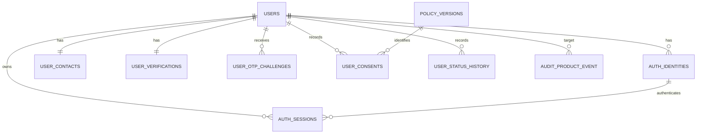

# Aditya — Identity, Authentication, and Account Lifecycle Database Design

## 1. Ownership and scope

Aditya owns the application's core identity module. This module is responsible for:

- creating a stable user account;
- supporting email OTP, phone OTP, Google, and Apple authentication;
- keeping email and phone changes attached to the same account;
- verifying email, phone, Aadhaar, PAN, age eligibility, and overall identity status;
- enforcing OTP expiry, retry, lock, resend, and recovery rules;
- issuing, rotating, validating, and revoking application sessions;
- storing consent decisions and the exact policy version involved;
- controlling suspension, deactivation, deletion, and reactivation;
- maintaining an append-only and sanitized audit trail.

The application uses a separate backend for authentication. The browser or mobile client must not directly write to these tables or receive the Supabase `service_role` key.

The current shared project contains synthetic test data only. Real Aadhaar numbers, PAN numbers, plaintext OTPs, plaintext access tokens, and plaintext refresh tokens must never be inserted.

## 2. Main design decisions

### Stable user identifier

`core.users` contains two identifiers:

- `id bigint`: internal database sequence key. It may have gaps and must not be exposed as the application user identifier.
- `user_id uuid`: random, stable business identifier used by all application relationships.

The application must use `user_id`. A sequence such as 1, 2, 3, 4 is guessable and is therefore not used as the public user identifier.

Changing email, phone, authentication provider, or account status does not change `user_id`, so profiles, messages, connections, reports, and account history remain attached to the same person.

### Logical deletion

Accounts are deleted through lifecycle status changes. Child foreign keys use `ON DELETE RESTRICT`, so application history cannot be silently removed with a physical cascade. `deleted` is a final account state.

### Sensitive values

- Aadhaar: only a masked value such as `XXXXXXXX1234`, a 32-byte keyed hash, provider, and provider reference may be stored.
- PAN: only a masked value such as `XXXPX1234A`, a 32-byte keyed hash, provider, and provider reference may be stored.
- OTP: only a backend-generated 32-byte HMAC is stored.
- Refresh token: only a 32-byte digest is stored.
- IP address: only a 32-byte HMAC may be stored.
- User agent: only a 32-byte hash may be stored.
- Audit records contain state changes, not complete Aadhaar, PAN, OTP, contact, or token values.

Secret keys used to generate HMACs belong in a backend secret manager, never in PostgreSQL rows, Git, a mobile application, or browser code.

## 3. Relationship overview

`core.users.user_id` is also referenced by the other team modules, including profiles, social connections, messaging, notifications, safety, account-data jobs, and analytics.

## 4. Table inventory

| Table | Purpose | Expected relationship per user |
|---|---|---:|
| `core.users` | Master account and lifecycle state | Exactly 1 |
| `core.auth_identities` | Login providers linked to an account | 0 to many |
| `core.user_contacts` | Current email and phone | Exactly 1 |
| `core.user_verifications` | Contact, Aadhaar, PAN, and age verification | Exactly 1 |
| `core.user_otp_challenges` | OTP attempts for signup, login, contact change, and recovery | 0 to many |
| `core.user_consents` | Append-only consent decisions | 0 to many |
| `core.user_status_history` | Append-only account-status changes | 1 to many |
| `core.policy_versions` | Immutable policy catalogue | Shared catalogue |
| `core.auth_sessions` | Revocable backend sessions and refresh-token state | 0 to many |
| `audit.audit_product_event` | Sanitized security and operational audit events | 0 to many |

## 5. Detailed table definitions

### 5.1 `core.users`

This is the parent account table.

| Column | Type | Required/default | Meaning and rules |
|---|---|---|---|
| `id` | `bigint` | Primary key; identity generated always | Internal database key only. Gaps are valid. |
| `user_id` | `uuid` | Required; random UUID; unique | Stable application identifier used by foreign keys. Immutable. |
| `account_status` | `text` | Required; default `limited` | One of `limited`, `active`, `suspended`, `deactivated`, `deletion_pending`, `deleted`. |
| `verification_status` | `text` | Required; default `pending` | One of `pending`, `verified`, `rejected`, `review_required`. Automatically synchronized from detailed verification states. |
| `timezone` | `text` | Required; default `Asia/Kolkata` | Must be a valid PostgreSQL/IANA timezone name. |
| `age_eligibility_status` | `text` | Required; default `unknown` | One of `unknown`, `eligible`, `ineligible`, `review_required`. |
| `age_verified_at` | `timestamptz` | Optional | Present after age eligibility is established from Aadhaar verification. |
| `date_of_birth` | `date` | Optional | Cannot be before 1900 or in the future. Locked after age verification. Cleared at final deletion. |
| `created_at` | `timestamptz` | Required; database clock | Account creation time. |
| `updated_at` | `timestamptz` | Required; database clock | Automatically refreshed; cannot precede `created_at`. |
| `deleted_at` | `timestamptz` | Optional | Must be present exactly when `account_status = 'deleted'` and cannot precede creation. |
| `gender` | `text` | Required; default `prefer_not_to_say` | `male`, `female`, `transgender_man`, `transgender_woman`, `non_binary`, `genderqueer`, `genderfluid`, `agender`, `other`, or `prefer_not_to_say`. |

Important rules:

- Direct changes to `account_status` are blocked. Use `core.change_account_status(...)`.
- On insert, the database automatically creates `core.user_verifications` and the initial `limited` status-history event.
- `user_id` cannot be changed.
- `eligible` and `ineligible` age decisions require `age_verified_at`; `unknown` requires it to be null. The `review_required` timestamp policy remains explicitly separate.
- Activation is allowed only after the complete access gates are satisfied.
- Suspended, deactivated, deletion-pending, and deleted accounts automatically lose active sessions.

### 5.2 `core.auth_identities`

Stores authentication providers linked to the same stable account.

| Column | Type | Required/default | Meaning and rules |
|---|---|---|---|
| `id` | `bigint` | Primary key; identity | Internal identity record key. |
| `user_id` | `uuid` | Required; FK to `core.users.user_id` | Identity owner; immutable; delete restricted. |
| `provider` | `text` | Required | `email_otp`, `phone_otp`, `google`, or `apple`. Immutable. |
| `provider_subject` | `text` | Required | Provider's nonblank unique subject. For OTP providers it must equal `user_id::text`. |
| `status` | `text` | Required; default `active` | `active`, `unlinked`, or `revoked`. A non-active identity cannot be reactivated. |
| `linked_at` | `timestamptz` | Required | Link creation time. |
| `last_login_at` | `timestamptz` | Optional | Must not precede `linked_at`. |
| `unlinked_at` | `timestamptz` | Optional | Required for `unlinked` or `revoked`; forbidden for `active`. |
| `unlink_reason` | `text` | Optional | Required for non-active state: `user_request`, `security`, `admin_action`, or `provider_revoked`. |
| `updated_at` | `timestamptz` | Required | Automatically updated. |

Uniqueness and behavior:

- `(provider, provider_subject)` is globally unique, preventing one provider identity from being attached to two users.
- A partial unique index allows only one active identity per `(user_id, provider)`.
- One user may safely link different providers, such as Google and email OTP.
- Email OTP identity requires verified email; phone OTP identity requires verified phone.
- Unlinking or revoking an identity automatically revokes its active sessions.

### 5.3 `core.user_contacts`

Stores the user's current normalized contact values.

| Column | Type | Required/default | Meaning and rules |
|---|---|---|---|
| `id` | `bigint` | Primary key; identity | Internal contact key. |
| `user_id` | `uuid` | Required; unique FK | Exactly one contact row per user; owner is immutable; delete restricted. |
| `email` | `text` | Required; globally unique | Trimmed and lowercased. Must match the database email-format rule. |
| `phone_number` | `text` | Required; globally unique | E.164-like form: `+`, nonzero country-code start, and 8–15 digits total. |
| `contact_version` | `integer` | Required; starts at 1 | Automatically increments whenever email or phone changes. Must be at least 1. |
| `created_at` | `timestamptz` | Required | Creation time. |
| `updated_at` | `timestamptz` | Required | Automatically updated. |

Contact-change behavior:

- The account keeps the same `user_id` and all history.
- The changed contact's verification returns to `not_started`.
- Pending OTP challenges for the old contact channel are cancelled.
- An active account returns to `limited` with reason `verification_reset`.
- Existing OTP requests contain `contact_version`; stale requests cannot verify a newer contact.
- The change produces a sanitized audit event containing the version change, not the contact value.

### 5.4 `core.user_verifications`

One row per user stores email, phone, Aadhaar, PAN, and age-verification state.

#### Contact verification columns

| Column | Type | Rule |
|---|---|---|
| `id` | `bigint` | Primary key; identity. |
| `user_id` | `uuid` | Required unique FK; one row per user; immutable; delete restricted. |
| `email_status` | `text` | `not_started`, `pending`, `verified`, or `failed`. |
| `email_verified_at` | `timestamptz` | Present exactly when email status is `verified`. |
| `phone_status` | `text` | `not_started`, `pending`, `verified`, or `failed`. |
| `phone_verified_at` | `timestamptz` | Present exactly when phone status is `verified`. |

#### Aadhaar verification columns

| Column | Type | Rule |
|---|---|---|
| `aadhaar_status` | `text` | `not_started`, `pending`, `verified`, `failed`, or `review_required`. |
| `aadhaar_failure_reason` | `text` | Required only for `failed` or `review_required`; allowed values are listed below. |
| `aadhaar_attempt_count` | `smallint` | Between 0 and 3. The third pending attempt becomes `failed / too_many_attempts`. |
| `aadhaar_started_at` | `timestamptz` | Set automatically when Aadhaar processing begins. |
| `aadhaar_failed_at` | `timestamptz` | Present only for `failed`. |
| `aadhaar_review_requested_at` | `timestamptz` | Present only for `review_required`. |
| `aadhaar_verified_at` | `timestamptz` | Present exactly for `verified`. |
| `aadhaar_masked` | `text` | Present exactly for `verified`; format `XXXXXXXX` plus four digits. |
| `aadhaar_provider` | `text` | `digilocker` or `kyc_vendor`; absent only when not started. |
| `aadhaar_provider_ref` | `text` | Provider-side audit/reference ID; globally unique with provider. |
| `aadhaar_hash` | `bytea` | Optional 32-byte keyed hash for duplicate detection; globally unique when present. |
| `age_eligible` | `boolean` | Present exactly when Aadhaar is verified. |

Allowed Aadhaar failure reasons:

`wrong_otp`, `otp_attempts_exceeded`, `otp_limit_exceeded`, `otp_expired`, `mobile_not_linked`, `invalid_aadhaar_number`, `aadhaar_not_found`, `aadhaar_inactive`, `aadhaar_locked`, `name_mismatch`, `dob_mismatch`, `already_used`, `user_cancelled`, `consent_denied`, `provider_error`, `too_many_attempts`.

Only `name_mismatch` and `dob_mismatch` may produce `review_required`.

#### PAN verification columns

| Column | Type | Rule |
|---|---|---|
| `pan_status` | `text` | `not_started`, `pending`, `verified`, `failed`, or `review_required`. |
| `pan_failure_reason` | `text` | Required only for `failed` or `review_required`; allowed values are listed below. |
| `pan_attempt_count` | `smallint` | Between 0 and 3. The third pending attempt becomes `failed / too_many_attempts`. |
| `pan_started_at` | `timestamptz` | Set automatically when PAN processing begins. |
| `pan_failed_at` | `timestamptz` | Present only for `failed`. |
| `pan_review_requested_at` | `timestamptz` | Present only for `review_required`. |
| `pan_verified_at` | `timestamptz` | Present exactly for `verified` and not before Aadhaar verification. |
| `pan_masked` | `text` | Present exactly for `verified`; masked project format `XXXPX9999A`. |
| `pan_provider` | `text` | `digilocker`, `protean`, or `kyc_vendor`; absent only when not started. |
| `pan_provider_ref` | `text` | Provider-side audit/reference ID; globally unique with provider. |
| `pan_hash` | `bytea` | Optional 32-byte keyed hash for duplicate detection; globally unique when present. |

Allowed PAN failure reasons:

`invalid_pan_format`, `pan_not_found`, `pan_inactive`, `pan_not_individual`, `pan_not_linked_to_aadhaar`, `name_mismatch`, `dob_mismatch`, `aadhaar_pan_name_mismatch`, `already_used`, `user_cancelled`, `consent_denied`, `provider_error`, `too_many_attempts`.

Only `name_mismatch`, `dob_mismatch`, and `aadhaar_pan_name_mismatch` may produce `review_required`.

#### Shared verification columns

| Column | Type | Rule |
|---|---|---|
| `hash_key_version` | `smallint` | Required and at least 1; identifies which backend HMAC key version produced the hashes. |
| `created_at` | `timestamptz` | Creation time. |
| `updated_at` | `timestamptz` | Automatically updated. |

Verification ordering and derived state:

1. Email and phone OTP verification can be completed independently.
2. Email and phone must both be verified before Aadhaar starts.
3. Current `kyc_verification` consent must be `granted` before Aadhaar starts.
4. Aadhaar must start before PAN starts.
5. PAN can be verified only after Aadhaar is verified.
6. Overall `core.users.verification_status` is automatically synchronized.
7. Each verification insert/update creates a sanitized audit event.
8. KYC must move through `not_started -> pending -> result`; failed verification may restart at pending, and a completed verified identity cannot be reset or have its evidence overwritten by an ordinary update.
9. Provider and provider reference are both required after Aadhaar or PAN processing starts.

### 5.5 `core.user_otp_challenges`

Stores one-time-password workflow state without storing the plaintext OTP.

| Column | Type | Required/default | Meaning and rules |
|---|---|---|---|
| `id` | `bigint` | Primary key; identity | Challenge ID. |
| `user_id` | `uuid` | Required FK | Challenge owner; delete restricted. |
| `channel` | `text` | Required | `email` or `phone`. Immutable after insert. |
| `purpose` | `text` | Required | `signup`, `login`, `contact_change`, or `account_recovery`. Immutable. |
| `destination_hash` | `bytea` | Optional | If present, exactly 32 bytes. Destination itself is not copied here. Immutable. |
| `contact_version` | `integer` | Required; at least 1 | Must equal the current contact version. Immutable. |
| `otp_hmac` | `bytea` | Required | Exactly 32 bytes. May change only through the authorized resend function. |
| `status` | `text` | Required; default `pending` | `pending`, `verified`, `expired`, `locked`, or `cancelled`. |
| `attempt_count` | `smallint` | Required; default 0 | Between 0 and 5. Five incorrect attempts lock the challenge. |
| `resend_count` | `smallint` | Required; default 0 | Between 0 and 5 within the current resend window. |
| `sent_at` | `timestamptz` | Set automatically | First send time. |
| `last_sent_at` | `timestamptz` | Set automatically | Latest send time; cannot precede `sent_at`. |
| `expires_at` | `timestamptz` | Set automatically | Ten minutes after the most recent send. |
| `resend_window_started_at` | `timestamptz` | Required | Beginning of the one-hour resend-rate window. |
| `verified_at` | `timestamptz` | Optional | Present exactly for `verified` and must fall inside the challenge lifetime. |
| `last_attempt_at` | `timestamptz` | Optional | Cannot precede `sent_at`. |
| `locked_at` | `timestamptz` | Optional | Present exactly for `locked`. |
| `recovery_request_id` | `uuid` | Optional | Permitted only for `account_recovery`; supports recovery traceability. |
| `created_at` | `timestamptz` | Required | Creation time. |
| `updated_at` | `timestamptz` | Required | Automatically updated. |

OTP operational rules:

- Only one pending challenge is allowed for each `(user_id, channel, purpose)`.
- A challenge expires after 10 minutes.
- A resend has a 60-second cooldown.
- At most five resends are allowed per one-hour window.
- Five incorrect attempts change status to `locked`.
- A successful signup OTP verifies the contact and creates its OTP authentication identity.
- A successful recovery OTP revokes every active session for that user.
- Contact changes cancel pending challenges for the old contact.

### 5.6 `core.user_consents`

Append-only user consent events. A withdrawal is a new event; it does not edit or delete the earlier grant.

| Column | Type | Required/default | Meaning and rules |
|---|---|---|---|
| `id` | `bigint` | Primary key; identity | Consent event ID. |
| `user_id` | `uuid` | Required FK | User who made the decision; delete restricted. |
| `consent_type` | `text` | Required | `terms_of_service`, `privacy_notice`, `kyc_verification`, or `marketing`. |
| `policy_version` | `text` | Required | Format `vN.N`; part of an FK to `core.policy_versions`. |
| `decision` | `text` | Required | `granted`, `declined`, or `withdrawn`. |
| `source` | `text` | Required | `signup_flow`, `settings`, `admin_console`, or `api`. |
| `captured_at` | `timestamptz` | Required | Server-recorded event time. |

Rules:

- Update and delete are blocked by an append-only trigger.
- `(user_id, consent_type, policy_version, captured_at)` is unique.
- `core.user_consents_current` returns the newest event for each user and consent type.
- Exact policy content provenance is available through the policy foreign key.
- Access gates accept only a grant linked to a policy version effective at the time of evaluation.
- Every insert creates a sanitized audit event.

### 5.7 `core.policy_versions`

Immutable catalogue of documents users can accept, decline, or withdraw from.

| Column | Type | Required/default | Meaning and rules |
|---|---|---|---|
| `consent_type` | `text` | Composite primary key | Same four consent types allowed in `user_consents`. |
| `policy_version` | `text` | Composite primary key | Format `vN.N`. |
| `content_sha256` | `bytea` | Required | Exactly 32 bytes; identifies the exact document content. |
| `document_uri` | `text` | Required | Must begin with `https://`. |
| `published_at` | `timestamptz` | Required | Publication time. |
| `effective_at` | `timestamptz` | Required | Must be at or after publication. |
| `retired_at` | `timestamptz` | Optional | If present, must be after effective time. |
| `created_at` | `timestamptz` | Required | Catalogue insertion time. |

Document content and identity fields are immutable. Effective periods for the same consent type cannot overlap. New versions are published through `core.publish_policy_version(...)`, which retires the current version and inserts the replacement atomically. `core.retire_policy_version(...)` is the controlled retirement path. A new policy is always a new version, preserving evidence for old consent events.

### 5.8 `core.user_status_history`

Append-only account-lifecycle audit history.

| Column | Type | Required/default | Meaning and rules |
|---|---|---|---|
| `id` | `bigint` | Primary key; identity | History event ID. |
| `user_id` | `uuid` | Required FK | Account whose status changed; delete restricted. |
| `from_status` | `text` | Optional | Null only for initial creation; otherwise a valid account state. |
| `to_status` | `text` | Required | New valid account state. |
| `actor_type` | `text` | Required | `user`, `admin`, `support`, or `system`. |
| `actor_id` | `text` | Conditional | Required for non-system actors; must be null for system; restricted safe-character format. |
| `reason_code` | `text` | Required | Controlled lifecycle reason listed below. |
| `effective_until` | `timestamptz` | Optional | Used only for `suspended` or `deletion_pending`; mandatory for deletion pending. |
| `request_id` | `text` | Optional | Trace/correlation ID with restricted safe-character format. |
| `created_at` | `timestamptz` | Required | Status-change time. |

Allowed reason codes:

`signup`, `verification_completed`, `verification_reset`, `policy_violation`, `fraud_suspected`, `report_upheld`, `age_ineligible`, `appeal_accepted`, `suspension_expired`, `user_request`, `user_returned`, `deletion_cancelled`, `grace_period_ended`, `inactivity`, `legal_request`.

Updates and deletes are blocked. Status changes are performed only by `core.change_account_status(...)`, which updates `core.users` and inserts this history row in one transaction.

### 5.9 `core.auth_sessions`

Backend-managed session and refresh-token state.

| Column | Type | Required/default | Meaning and rules |
|---|---|---|---|
| `session_id` | `uuid` | Primary key; random UUID | Session identifier. |
| `session_family_id` | `uuid` | Required; random UUID | Groups refresh-token rotations for compromise handling. |
| `user_id` | `uuid` | Required FK | Session owner; delete restricted. |
| `auth_identity_id` | `bigint` | Required FK | Active identity used to authenticate; delete restricted. |
| `refresh_token_hash` | `bytea` | Required; unique | Exactly 32 bytes. Plaintext token is never stored. |
| `refresh_token_version` | `integer` | Required; starts at 1 | Increments on successful rotation; must be at least 1. |
| `device_id` | `varchar(100)` | Optional | Backend/device correlation identifier. |
| `ip_hmac` | `bytea` | Optional | Exactly 32 bytes when present. |
| `user_agent_hash` | `bytea` | Optional | Exactly 32 bytes when present. |
| `status` | `text` | Required; default `active` | `active`, `revoked`, `expired`, or `compromised`. |
| `created_at` | `timestamptz` | Required | Session creation time. |
| `last_seen_at` | `timestamptz` | Required | Cannot precede creation. |
| `expires_at` | `timestamptz` | Required | Absolute expiry; later than creation. Issued at 30 days. |
| `idle_expires_at` | `timestamptz` | Required | Idle expiry; later than creation. Issued/refreshed at up to 7 days. |
| `revoked_at` | `timestamptz` | Conditional | Null for active; required for every non-active status. |
| `revocation_reason` | `text` | Conditional | Null for active; required for every non-active status. |
| `replaced_at` | `timestamptz` | Optional | Latest successful refresh-token rotation time. |
| `updated_at` | `timestamptz` | Required | Last database update time. |

Session rules:

- A session can be issued only for a login-eligible user and an active linked identity.
- A composite foreign key proves that `auth_identity_id` belongs to the same `user_id` stored on the session.
- Login eligibility requires account status `limited` or `active` plus verified email and phone.
- Refresh-token rotation replaces the stored digest and increments its version.
- Version 1 has no replacement timestamp; later versions require one.
- Idle expiry and last-seen time cannot exceed absolute expiry.
- Presenting a wrong/old digest marks the active session family `compromised`.
- A single session or all user sessions can be revoked.
- Account recovery revokes all active sessions.
- Suspension, deactivation, deletion-pending, or deletion revokes all active sessions.
- Identity unlink/revocation revokes sessions created through that identity.

### 5.10 `audit.audit_product_event` usage

The shared audit table records relevant identity events with:

- event time;
- actor type;
- action type and category;
- target user;
- request/correlation ID when provided;
- success/failure status;
- source;
- sanitized previous and new state;
- metadata such as database role and trigger operation.

Identity actions generated automatically include:

- `registration_started`;
- `identity_verification_changed`;
- `auth_identity_changed`;
- `contact_changed`;
- `otp_challenge_changed`;
- `consent_recorded`;
- `auth_session_changed`.

The table itself is append-only. Identity audit payloads contain workflow states and counters, not secrets or full identity documents.

## 6. Account lifecycle state machine

All transitions require an allowed reason. Direct updates are rejected.

| From | To | Allowed reasons |
|---|---|---|
| `limited` | `active` | `verification_completed` and all activation gates pass |
| `limited` | `suspended` | `policy_violation`, `fraud_suspected`, `report_upheld`, `age_ineligible` |
| `limited` | `deactivated`, `deletion_pending` | `user_request`, `inactivity`, `legal_request` |
| `active` | `limited` | `verification_reset` |
| `active` | `suspended` | `policy_violation`, `fraud_suspected`, `report_upheld`, `age_ineligible` |
| `active` | `deactivated`, `deletion_pending` | `user_request`, `inactivity`, `legal_request` |
| `suspended` | `limited`, `active` | `appeal_accepted`, `suspension_expired` |
| `suspended` | `deletion_pending` | `user_request`, `legal_request` |
| `deactivated` | `limited`, `active` | `user_returned` |
| `deactivated` | `deletion_pending` | `user_request`, `inactivity`, `legal_request` |
| `deletion_pending` | `limited`, `active` | `deletion_cancelled` |
| `deletion_pending` | `deleted` | `grace_period_ended` |

Additional rules:

- Deletion pending defaults to a 30-day effective/grace time when none is supplied.
- An applicable active legal hold can block the final transition to `deleted`.
- `deleted` is final.
- Entering a blocked lifecycle state revokes active sessions.
- Every successful change records actor, reason, request ID, effective time, and timestamp.

## 7. Access gates and routing

### Login gate: `core.user_can_login(user_id)`

Returns true only when:

- account status is `limited` or `active`;
- email is verified;
- phone is verified.

### Main-application gate: `core.user_access_ready(user_id)`

Returns true only when:

- email and phone are verified;
- Aadhaar and PAN are verified;
- age is eligible;
- date of birth shows the user is at least 18;
- current Terms of Service consent is granted;
- current Privacy Notice consent is granted;
- current KYC consent is granted.

### Application routing: `core.user_access_level(user_id)`

Returns one of:

- `blocked_lifecycle`;
- `contact_verification`;
- `kyc_retry_or_review`;
- `onboarding_kyc`;
- `main_app`.

## 8. Backend functions

| Function | Responsibility |
|---|---|
| `core.register_user(...)` | Creates user, contact, required signup consents, authentication identity or signup OTP, and registration audit event in one transaction. |
| `core.link_auth_identity(...)` | Links an additional provider to a non-deleted user and rejects duplicates. |
| `core.resend_otp_challenge(...)` | Applies cooldown/rate limits, rotates OTP HMAC, and extends expiry. |
| `core.verify_otp_challenge(...)` | Applies expiry/attempt locking, verifies contact, creates signup OTP identity, or revokes sessions after recovery. |
| `core.issue_auth_session(...)` | Issues a 30-day/7-day-idle session using only a token digest. |
| `core.rotate_refresh_token(...)` | Rotates the digest or marks token reuse as compromise. |
| `core.revoke_auth_session(...)` | Revokes one active session. |
| `core.revoke_all_user_sessions(...)` | Revokes every active session for a user. |
| `core.validate_auth_session(...)` | Returns the user only for an active, unexpired session, allowed account, and active identity. |
| `core.change_account_status(...)` | Enforces lifecycle transitions and writes history atomically. |
| `core.user_can_login(...)` | Evaluates login eligibility. |
| `core.user_access_ready(...)` | Evaluates complete application-access readiness. |
| `core.user_access_level(...)` | Selects the correct application route. |
| `core.publish_policy_version(...)` | Atomically retires the effective version and publishes a non-overlapping replacement. |
| `core.retire_policy_version(...)` | Records the first controlled retirement time without allowing policy content changes. |
| `core.policy_version_is_effective(...)` | Checks whether one exact policy version is effective at a given time. |
| `core.user_has_current_consent(...)` | Checks that the user's latest decision is a grant for a currently effective policy. |

All sensitive functions are `SECURITY DEFINER` functions with an empty fixed search path. Execute permission is removed from `public`, `anon`, and `authenticated`; only `service_role` can call them.

## 9. Security and access controls

- Row Level Security is enabled on all application tables.
- `anon` and `authenticated` have no direct schema/table/function privileges for the core identity data.
- The trusted backend uses `service_role`; this credential must never reach a client.
- Team reviewers receive only approved sanitized `review` views through the no-login reviewer role.
- Aadhaar/PAN references and hashes remain in protected core tables and are excluded from student review views.
- Consent, policy, lifecycle history, and audit events are append-only.
- All foreign-key deletes are restricted, preventing silent destruction of audit/history records.
- Unique constraints stop duplicate contacts, duplicate provider identities, reused verification hashes, and reused refresh-token hashes.
- Database timestamps are used for security decisions; client-supplied clocks are not trusted.

## 10. Main indexes

| Table | Index purpose |
|---|---|
| `core.auth_identities` | Fast lookup by user; unique provider subject; one active identity per user/provider. |
| `core.user_verifications` | Unique Aadhaar/PAN provider references and hashes. |
| `core.user_otp_challenges` | One pending challenge per user/channel/purpose; recent-user lookup; cleanup of completed challenges. |
| `core.user_consents` | Latest consent lookup by user/type/time. |
| `core.user_status_history` | Latest status history lookup by user/time. |
| `core.auth_sessions` | User/status/expiry lookup; session-family compromise lookup; unique refresh-token digest. |
| `audit.audit_product_event` | Time, user, admin, action, and request-ID audit lookup. |

## 11. End-to-end flows

### Registration

1. Backend validates request and calls `core.register_user(...)`.
2. Database generates random `user_id` and creates verification/history rows.
3. Database creates contact and Terms/Privacy consent events.
4. Google/Apple creates an active linked identity immediately.
5. Email/phone registration creates a signup OTP challenge; identity is created only after successful OTP verification.
6. Registration is recorded with request ID for traceability.

### Contact change

1. Backend changes the existing contact row, not the user row.
2. `contact_version` increments.
3. Corresponding contact verification resets.
4. Old pending OTPs are cancelled.
5. Active account returns to limited until re-verification.
6. User history remains because `user_id` does not change.

### Aadhaar and PAN verification

1. Verify both contacts and obtain KYC consent.
2. Start Aadhaar with approved provider/reference and transition timestamp.
3. Store only masked value and keyed hash after success.
4. Start PAN only after Aadhaar has started; verify PAN only after Aadhaar success.
5. Store failure/review state, reason, timestamp, provider reference, and attempts for auditability.
6. Never store raw document numbers.

### Login and refresh

1. Backend authenticates through one linked provider.
2. `core.issue_auth_session(...)` checks account/contact/identity state.
3. Backend returns plaintext tokens to the client but stores only a digest in the database.
4. Refresh rotation replaces the digest and increments version.
5. Old-token reuse compromises the session family.

### Consent withdrawal

1. Insert a new `withdrawn` consent event with exact policy version and source.
2. Earlier grant remains unchanged for historical evidence.
3. `core.user_consents_current` exposes the newest decision.
4. Any access gate requiring that consent stops passing.

### Suspension and deletion

1. Backend calls `core.change_account_status(...)` with actor, reason, and request ID.
2. Database validates the transition and legal-hold rule.
3. Account row and append-only history update in one transaction.
4. Blocked lifecycle states revoke sessions.
5. Final deletion clears date of birth and is irreversible at the account-state level.

## 12. Validation files

- `supabase/tests/aditya_auth_lifecycle_queries.sql`: 12 simple read-only checks corresponding to Aditya's eight review questions.
- `supabase/tests/identity_lifecycle_contract.sql`: transactional behavior tests for registration, provider linking, OTP, sessions, lifecycle revocation, consent, and audit.
- `scripts/validate-identity-lifecycle.ps1`: executes the lifecycle contract against the linked project and rolls back test changes.
- `supabase/migrations/20261109090000_core_identity.sql`: original identity tables and constraints.
- `supabase/migrations/20261109100000_routines_security.sql`: lifecycle, access, trigger, RLS, and privilege rules.
- `supabase/migrations/20261110100000_identity_lifecycle_completion.sql`: policies, sessions, OTP limits, transition timestamps, functions, and audit additions.
- `supabase/migrations/20261110102000_registration_request_audit.sql`: registration request audit completion.
- `supabase/migrations/20261111100000_aditya_gap_hardening.sql`: session ownership/expiry, age consistency, KYC transitions, non-overlapping policy lifecycle, and focused FK indexes.
- `supabase/tests/aditya_gap_hardening_contract.sql`: negative and positive regression tests for the 11 November Aditya gap review.

## 13. Production integration checklist

- Keep the Supabase service-role key only in the separate backend.
- Use a proper secret manager and key rotation for OTP, Aadhaar/PAN, and IP HMAC keys.
- Use a cryptographically secure random OTP and compare HMACs in constant-time application code where applicable.
- Add provider webhook verification and idempotency at the backend boundary.
- Replace all example policy URLs/content hashes with approved production documents before real users.
- Define retention and purge schedules with legal/compliance approval.
- Monitor locked OTPs, resend-limit events, compromised sessions, verification failures, and lifecycle changes.
- Test backup/restore, disaster recovery, and audit export.
- Complete a privacy, security, and legal review before storing real identity-verification data.
- Continue using migrations and GitHub review for every schema change; do not edit production structure manually.

This document describes the implemented database design as of 11 November 2026. The SQL migrations remain the final executable source of truth.
